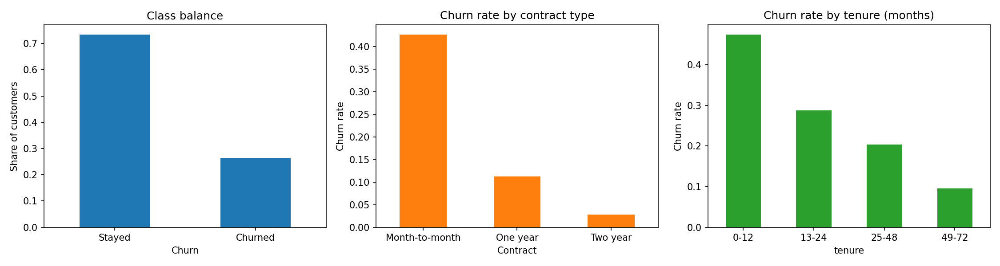
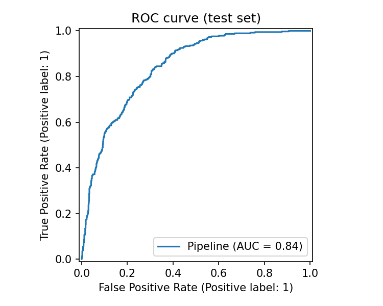
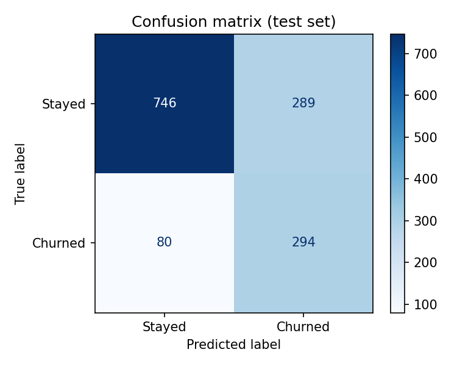
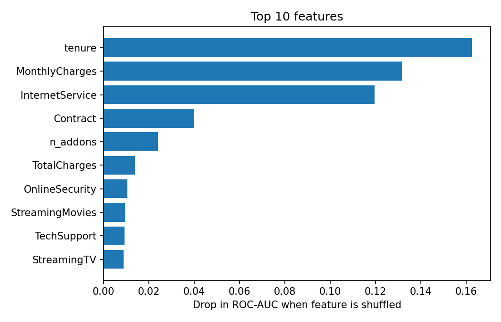

# Telco Customer Churn Prediction

An end-to-end machine learning project that predicts which telecom customers are likely to cancel their service, so a retention team can contact them **before** they leave.

**Dataset:** [Telco Customer Churn](https://www.kaggle.com/datasets/blastchar/telco-customer-churn) (Kaggle): 7,043 customers, 19 features plus a churn label
**Tech stack:** Python, pandas, scikit-learn, matplotlib

---

## 1. Problem

Winning a new customer costs far more than keeping an existing one. Given a customer's contract, services, billing, and tenure, the goal is to estimate the **probability that the customer churns** and rank customers by risk, so retention offers go to the people most likely to leave.

Only **26.5%** of customers churn, so the data is imbalanced and plain accuracy would be misleading (a model that predicts "stays" for everyone would score about 73.5%). I therefore evaluate with **ROC-AUC, recall, precision, and F1**.

## 2. Approach

1. **Cleaning:** `TotalCharges` is stored as text and is blank for brand-new customers (tenure = 0). I converted it to numeric and filled the blanks with 0.
2. **Feature engineering:** `n_addons` (number of add-on services a customer has) and `avg_monthly_spend` (total charges divided by tenure).
3. **Preprocessing:** scaling for numeric features and one-hot encoding for categorical ones, inside a scikit-learn `Pipeline` so that no information leaks from the test set.
4. **Model comparison:** Logistic Regression, Random Forest, and Gradient Boosting, compared with 5-fold stratified cross-validation on the training set (80% of the data).
5. **Tuning:** grid search on the best model, scored by ROC-AUC.
6. **Evaluation:** a stratified 20% test set (1,409 customers) that was not used until the end.
7. **Interpretation:** permutation feature importance, plus a threshold analysis of the precision/recall trade-off.

## 3. Results

### Model comparison (5-fold cross-validation, training set)

| Model | ROC-AUC | F1 |
|---|---|---|
| **Logistic Regression** | **0.846** | **0.628** |
| Gradient Boosting | 0.835 | 0.565 |
| Random Forest | 0.828 | 0.607 |

Logistic Regression scored highest on both metrics, so it was selected and tuned (best setting: `C = 10`, cross-validated ROC-AUC 0.846). A simple, interpretable model outperforming tree-based models is common on small tabular datasets with mostly linear relationships.

> Note: Gradient Boosting was trained without class weighting, which lowers its F1 at the default 0.5 threshold. Its ROC-AUC is closer to the other models.

### Final model on the held-out test set

| Metric | Score |
|---|---|
| ROC-AUC | **0.841** |
| Recall (churners) | **0.786** |
| Precision (churners) | 0.504 |
| F1 | 0.614 |
| Accuracy | 0.74 |

**What this means:**
- The model catches about **79% of the customers who actually churn** (recall).
- About **half of the customers it flags** really do leave (precision).
- A test ROC-AUC of 0.84 is close to the cross-validated 0.846, so the model is not overfitting.
- The trade-off is deliberate. Class weights make the model favor catching churners, because offering a discount to a customer who would have stayed costs much less than losing a customer.

### Figures

| EDA overview | ROC curve |
|---|---|
|  |  |

| Confusion matrix | Top features |
|---|---|
|  |  |

## 4. Key findings and business recommendations


- **Who churns:** Churn is strongly tied to contract type and tenure (see `eda_overview.png`). Month-to-month customers churn at roughly 43%, compared with about 11% on one-year and about 3% on two-year contracts. Customers in their first year are the most likely to leave (about 47% churn for 0-12 months of tenure), and the rate falls steadily to under 10% for customers with 49-72 months of tenure.
- **What drives the model:** The three most important features are **tenure**, **monthly charges**, and **internet service type**. Shuffling tenure lowers the test ROC-AUC by about 0.16, monthly charges by about 0.13, and internet service by about 0.12 (see `feature_importance.png`). Contract type ranks fourth (about 0.04), even though it shows a large gap in the raw churn rates, likely because it overlaps with tenure. The engineered feature `n_addons` ranks fifth, so it added useful signal.
- **Recommended action:** Focus retention effort on new customers (first 12 months) on month-to-month contracts, for example with an incentive to move to a one- or two-year contract, since those groups show the highest churn and long-contract customers rarely leave.
- **Choosing a threshold:** `reports/threshold_analysis.csv` shows, for thresholds from 0.3 to 0.7, how many customers are flagged and how many churners are caught. A lower threshold catches more churners but contacts more customers who would have stayed. The right setting depends on the cost of a retention offer compared with the value of a retained customer.

## 5. Project structure

```
telco-churn-prediction/
├── data/                  # place the Kaggle CSV here (not committed)
├── src/
│   ├── train.py           # full pipeline: clean, EDA, compare, tune, evaluate
│   └── predict.py         # score new customers with the saved model
├── reports/
│   ├── figures/           # EDA, ROC curve, confusion matrix, feature importance
│   ├── metrics.json
│   ├── model_comparison.csv
│   ├── threshold_analysis.csv
│   └── feature_importance.csv
├── models/                # saved model (churn_model.joblib)
└── requirements.txt
```

## 6. How to run

```bash
# 1. Install dependencies (Python 3.9+)
pip install -r requirements.txt

# 2. Download the dataset from Kaggle and place it at:
#    data/WA_Fn-UseC_-Telco-Customer-Churn.csv

# 3. Train, evaluate, and generate all reports
python src/train.py

# 4. Score new customers (same columns as the original CSV)
python src/predict.py --input data/new_customers.csv --output reports/predictions.csv
```

## 7. Limitations and next steps

- The dataset is a single snapshot, so the model cannot learn how a customer's behavior changes over time.
- The best value of `C` (10) was at the edge of the search grid, so a wider range could give a small improvement.
- Predicted probabilities are not calibrated, so they should be treated as risk scores rather than exact probabilities.
- Next: try XGBoost or LightGBM with class weighting, use SHAP for per-customer explanations, and deploy the model as a FastAPI service on Azure or AWS.

## 8. Author

**Param Pratap Bhardwaj**, B.Tech Computer Science and Engineering, Meerut Institute of Technology
GitHub: [param5205](https://github.com/param5205)
